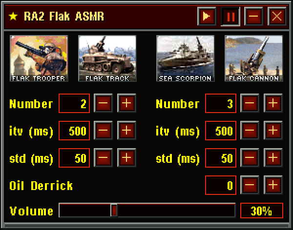

# RA2 Flak ASMR

《红色警戒 2》防空炮音效的无限流 ASMR 生成器。Windows 本地程序，采用原版点阵字形和像素界面，支持两组单位独立设置数量、开火间隔和标准差，以及按原版全局金钱计数器播放的油井进账声。



## 下载与运行

从 [Releases](https://github.com/winston-wen/ra2-flak-asmr/releases/latest) 下载 `RA2FlakASMR.exe`，双击运行。仅需这一个文件：音效、图像、图标和字体均已内嵌，无旁置第三方 DLL。

运行环境：Windows 10 / 11 x64，系统 .NET Framework 4.8。程序默认暂停，不安装字体、不联网。

- 空格：窗口内任意位置获得焦点后播放 / 暂停，编辑数值时先确认输入。
- 点击数值：键盘输入；Enter 确认，Esc 取消，Tab 切换。
- 加减按钮：单击调整，按住连续调整；对应行也支持滚轮。
- 音量：拖动底部滑块、滚轮或点击百分比输入；Ctrl+↑ / ↓ 每次调整 5%。
- 拖动标题栏移动窗口；F1 查看字体署名。

两组默认间隔均为 **500 ms**，标准差均为 **50 ms**；单位数分别为 2 和 3，音量 30%，油井数量默认为 0。标准差不超过均值，降低均值时同步截断。完整说明见 [使用说明](docs/使用说明.md)。

## 从源码构建

在项目根目录打开 PowerShell：

```powershell
./build.ps1
./test.ps1
```

产物为 `dist/RA2FlakASMR.exe`。日常构建使用 Windows 自带的 .NET Framework C# 编译器，无需 NuGet、Python 或第三方音频 DLL。也可用 Visual Studio 打开 `src/RA2FlakASMR.csproj`。

`test.ps1` 不依赖真实音频设备：检查混音、交互，以及程序画面与最终原型的逐像素一致性。要额外测试本机 WASAPI 音频设备，运行 `./test.ps1 -Device`；设备测试使用零主音量。

1.1 版本优化了整块声部混音、增益包络、字形缓存及局部绘制，并接入系统 MMCSS 音频调度。`./tools/benchmark.ps1 -Live` 可记录本机混音耗时和真实设备下的界面延迟，测试保持零输出音量。算法与实测数据见 [性能说明](docs/性能说明.md)。

1.1.1 将标题栏移动改为鼠标捕获拖动，保留普通消息循环，并缓存整数放大后的画面。`./tools/benchmark.ps1 -Drag` 额外测量 10+10 单位、500 ms 下的持续模拟窗口拖动与完整绘制；此测试不包含桌面合成器显示延迟。

1.1.2 修复音频通知延迟或丢失时的供数中断：等待上限由固定 100 ms 改为实际缓冲时长的三分之一，最多 10 ms，超时后主动检查余量。`./test.ps1 -Device` 包含屏蔽全部音频通知的真实设备测试；普通 CI 额外检查两列 10/500/100 连续生成 10 分钟的 PCM。

1.1.3 为所有单位独立随机起步，取消每组第一个单位固定立即开火；每次打开程序使用新的随机种子。暂停恢复、新增单位也会随机起步，标准差为 0 时仍保持错开的节奏。调整平均间隔时按比例保留剩余时间，避免多个单位被挤到同一开火时刻。

1.2.0 新增 Oil Derrick（0–32）。新增油井奖励 1000，每座每 100 逻辑帧收入 20；按 60 帧/秒推进。所有油井共用余额和显示计数器，显示变化触发唯一的 CreditUp 声道，连续触发会替换前一声。暂停冻结进账，恢复不重复奖励。详见 [油井逻辑](docs/油井进账逻辑.md)。

## 自动 Release

仓库配置了 [GitHub Actions 工作流](.github/workflows/release.yml)：

- 每次推送到 `main`：自动构建、测试并发布 `build-<运行编号>` Release。
- 推送 `v*` 标签：以该标签发布 Release。
- Pull Request：只构建和测试，不发布。
- 可在 Actions 页面手动运行。

Release 附带 `RA2FlakASMR.exe` 和 `SHA256SUMS.txt`。使用仓库内置 `GITHUB_TOKEN`，不需要额外设置个人访问令牌。构建或测试失败不会发布；重新运行同一次工作流会更新同一 Release。首次上传与维护说明见 [发布说明](docs/发布说明.md)。

## 项目结构

```text
src/                     C# 程序、WASAPI 引擎与工程文件
assets/audio/            内嵌用 PCM 音效及 original/ 中的 OGG / WAV 原件
assets/images/           单位图标、按钮图集和像素面板
assets/fonts/            原始 FNT、可编辑原型用 TTF、运行时点阵数据和许可
design/                  最新版可编辑 draw.io / SVG
docs/                    使用、开发、发布说明及界面参考图
tools/                   资源转换、设计导出和自动发布脚本
build.ps1 / test.ps1      本地与 CI 共用的构建、验证入口
dist/                    本机生成的单 EXE（不提交 Git）
```

## 界面与音频

界面按 300×236 的逻辑像素绘制，以整数倍显示。按钮使用相似矩形的开立方强度渐变，三态字形粗细相同，按下时绘制凹边。数值、图标与音量区使用统一对齐基准。

九段音效在启动时全部载入内存。持续运行的 WASAPI 输出流负责混音；触发音效时不打开文件。PCM 边缘、主音量和单位移除分别做平滑处理，降低启停爆音。默认输出缓冲目标为 30 ms，实际响应还受系统设备影响。

如何修改资源及同步原型，见 [开发说明](docs/开发说明.md)。

## 资源署名

Westwood Improved Font 原作者 Westwood，修订 mah_boi，使用 CC BY-NC 4.0；原字形逐像素保留。字体原件、许可和署名均随项目保存。红警 2 游戏音效与单位图像归原权利人所有。详见 [第三方资源说明](THIRD_PARTY_NOTICES.md)。
